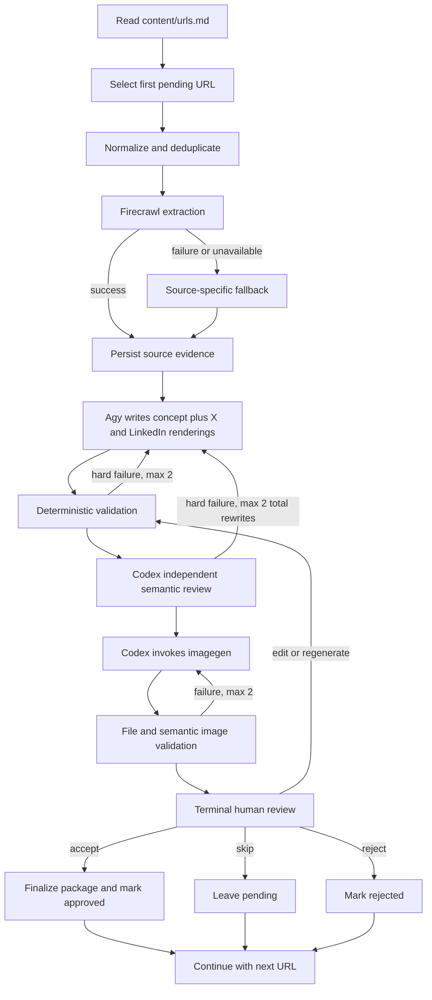

# Local Python Social Media Agent — Implementation Plan

## 1. Goal and success criteria

Replace the current TypeScript/LangGraph system with a small local Python CLI that reads URLs from Markdown, produces human-approved draft packages, and publishes accepted packages for one local operator.

One URL produces one content concept with two platform renderings:

- LinkedIn copy formatted for readability and professional context.
- X copy expressing the same concept within the configured length budget.
- Neither rendering contains a URL.
- Both renderings share one mandatory image generated by Codex through `$imagegen`.
- Acceptance immediately publishes the immutable approved package through the direct OAuth 2.0 developer APIs: X first, then LinkedIn. Each platform receives its approved rendering and exact approved image.
- Scheduling, analytics, remote editing or deletion, threads, organization-page publishing, additional platforms, and remote orchestration are out of scope.

The implementation is complete when `uv run social-agent run` works without LangGraph, LangSmith, Supabase, hosted LLM SDKs, or social-platform credentials; supports general pages, GitHub, Reddit, and YouTube; resumes after interruption without duplicate work; and saves an approved, validated local package for every accepted URL.

## 2. Target workflow

Every stage persists its output before the next stage starts. Resumption begins at the first incomplete stage, not from the beginning.

## 3. Public interfaces and data contracts

### CLI

Build a Typer application exposed as `social-agent`:

- `run --input content/urls.md`: process pending URLs sequentially and enter human review.
- `resume`: resume the oldest nonterminal job from its persisted stage.
- `status`: print queue counts, active job, last error, and next action without mutation.
- `retry-failed [POST_ID]`: move one or all failed jobs back to their recorded retry stage.
- `review POST_ID`: reopen an existing reviewable package.

`run` acquires an advisory lock under `output/.run.lock`; a second writer exits with a clear message. `status` remains available while locked. SIGINT/SIGTERM finishes the current atomic write, records `interrupted`, and exits without advancing the queue item.

### Input files

`content/urls.md` accepts Markdown checkbox items. A bare URL is sufficient; indented `Angle:` and `Audience:` fields are optional. Checked items are treated as user-managed display only: runtime truth lives in `output/state.json`, and the application updates the matching checkbox only after human acceptance.

`content/brand.md` is required and contains business context, audience, voice, forbidden claims/phrases, formatting preferences, and example posts. It is context, not executable instruction; prompt templates remain controlled by the application.

### Domain models

Use strict Pydantic models with `schema_version = 1`:

- `QueueItem`: stable ID, original URL, normalized URL, optional angle/audience, source line.
- `JobRecord`: post ID, stage, attempts by stage, timestamps, artifact paths, last error.
- `ExtractedSource`: canonical URL, source type, title, author/date, clean content, metadata, extraction method.
- `DraftPackage`: canonical concept, LinkedIn rendering, X rendering, image brief.
- `ValidationReport`: pass/fail, typed errors and warnings, deterministic metrics, suggested fix.
- `ImageArtifact`: workspace-relative path, MIME type, dimensions, SHA-256, prompt, validation result.
- `ApprovedManifest`: immutable snapshot of source, final renderings, image, validation, and approval timestamp.

Persist state atomically by writing a sibling temporary file, flushing it, then replacing `output/state.json`. Unknown schema versions fail closed with a migration error. Each post stores human-readable artifacts under `output/posts/<post-id>/` alongside its JSON contracts.

### State machine

Allowed stages are `pending`, `extracting`, `drafting`, `validating`, `generating_image`, `validating_image`, `human_review`, `approved`, `rejected`, `failed`, and `interrupted`. Only the pipeline owns transitions. A failed record stores `failed_stage` so retry resumes at that stage. Approved and rejected are terminal.

## 4. Implementation phases and tasks

### Phase 0 — Project foundation and durable memory

- **P0.1** Replace the root package metadata with a Python 3.11+ Hatchling project managed by `uv`; expose `social-agent = social_media_agent.cli:app`.
- **P0.2** Add runtime dependencies: `typer`, `rich`, `pydantic`, `httpx`, `firecrawl-py`, `trafilatura`, `tenacity`, `pillow`, `youtube-transcript-api`, and `python-dotenv`. Add `pytest`, `pytest-asyncio`, `pytest-cov`, `respx`, `ruff`, and `mypy` for development.
- **P0.3** Create the `src/social_media_agent` package, configuration loader, typed error hierarchy, logging setup, and CLI shell.
- **P0.4** Add `content/urls.md`, `content/brand.md`, `output/.gitkeep`, and ignore runtime contents except the placeholder.
- **P0.5** Configure Ruff, mypy strict mode for application code, pytest, and coverage. Gate: install, import, `--help`, lint, type-check, and empty test suite all succeed.

### Phase 1 — Queue, state, artifacts, and resumption

- **P1.1** Parse checkbox URLs plus optional `Angle` and `Audience`; report line-specific errors and ignore headings/comments/blank lines.
- **P1.2** Normalize URLs: lowercase scheme/host, remove fragments and tracking parameters, normalize trailing slash, canonicalize YouTube short links and Reddit `old`/`www` hosts, while preserving content-significant query parameters.
- **P1.3** Implement stable post IDs from normalized URL hashes, duplicate detection, atomic state writes, job transitions, and the single-writer advisory lock.
- **P1.4** Implement the per-post artifact repository and manifest builder. Store only relative paths in state so the worktree can move.
- **P1.5** Implement `status`, signal-safe interruption, and resume selection. Gate: a simulated interruption at every stage resumes exactly once without losing an artifact or duplicating a job.

### Phase 2 — Firecrawl-first extraction

- **P2.1** Define one extractor protocol and dispatcher for `general`, `github`, `reddit`, and `youtube` URLs.
- **P2.2** Attempt Firecrawl first when `FIRECRAWL_API_KEY` is configured. On missing configuration, timeout, rate limit, malformed content, or unusable response, record the reason and invoke the matching fallback.
- **P2.3** General fallback: `httpx` fetch with bounded redirects/size/timeouts, then `trafilatura` readable-text extraction.
- **P2.4** GitHub fallback: unauthenticated GitHub REST with optional `GITHUB_TOKEN`; obtain repository metadata, README, and small root project manifests. Do not clone arbitrary repositories.
- **P2.5** Reddit fallback: fetch the public post JSON and a bounded set of top-level comments; fall back to readable HTML when JSON is unavailable. Do not require Reddit credentials.
- **P2.6** YouTube fallback: parse video ID, fetch public metadata, then transcript through `youtube-transcript-api`; fail with a precise non-transcript error rather than inventing content.
- **P2.7** Sanitize and cap source text, retain provenance, and wrap it as untrusted quoted evidence for downstream prompts. Gate: fixture-backed tests cover all four types and every fallback path.

### Phase 3 — Local CLI agents and draft generation

- **P3.1** Implement a subprocess runner using argument arrays, `shell=False`, explicit cwd/environment allowlist, captured output, process-group cancellation, and timeouts (5 minutes for text, 15 minutes for image work).
- **P3.2** Implement `AgyWriter` with `agy --print <prompt>`. Prompts reference persisted source/brand files instead of embedding oversized page content. Extract a single JSON object from stdout, validate it, make one repair call for malformed JSON, then count the attempt as failed.
- **P3.3** Define the writer contract: one canonical concept, one LinkedIn rendering, one X rendering, and one image brief. The renderings must express the same claims, contain no URLs, and avoid unsupported facts.
- **P3.4** Implement `CodexReviewer` with `codex exec --ephemeral --sandbox read-only --output-schema <schema> -C <repo>`. Use a fresh invocation per review and validate the returned JSON independently.
- **P3.5** Redact secrets from subprocess logs; persist prompts by template/version and save raw agent output only inside the local post artifact directory. Gate: mocked agent tests cover success, timeout, nonzero exit, invalid JSON, repair, and cancellation.

### Phase 4 — Text validation and rewrite loop

- **P4.1** Add deterministic checks: required fields, no URLs, no agent markup, no forbidden phrases, nonempty distinct renderings, duplicate similarity, and matching source language unless configured otherwise.
- **P4.2** Apply platform rules: X target maximum 260 Unicode characters to leave operational headroom; LinkedIn target 600–1,300 characters with paragraph spacing and a warning—not failure—outside the target unless it exceeds LinkedIn's platform maximum.
- **P4.3** Have Codex independently review grounding, relevance, brand alignment, unsupported claims, platform adaptation, concept equivalence, and image-brief relevance.
- **P4.4** On hard failure, provide structured errors and suggested fixes to a fresh Agy rewrite. Allow two total rewrite attempts; afterward persist `failed` with the complete validation evidence.
- **P4.5** Version prompts and validation schemas so approved manifests identify exactly which policy produced them. Gate: adversarial fixtures cover prompt injection, fabricated claims, hidden URLs, length violations, and disagreement between platform renderings.

### Phase 5 — Mandatory Codex image generation

- **P5.1** Convert the validated image brief into the `imagegen` production schema: editorial technical illustration by default, 1536×1024 landscape, no embedded text, logos, or watermarks.
- **P5.2** Invoke Codex in workspace-write mode with `$imagegen`, require it to copy the selected final into `output/posts/<post-id>/image.png`, and request a structured final response containing the path and final prompt. Never rely on an asset remaining only under `$CODEX_HOME`.
- **P5.3** Verify path confinement, existence, decodability, MIME type, exact or acceptable dimensions/aspect ratio, nonzero size, and SHA-256. Reject symlinks and paths outside the post directory.
- **P5.4** Run a fresh read-only Codex review with the image attached to evaluate relevance, unwanted text/logos/watermarks, and consistency with the post. Regenerate with feedback up to two times; no valid image means the job fails.
- **P5.5** Persist the final prompt, review, dimensions, hash, and generator identity in `ImageArtifact`. Gate: mock generation plus a manually opted-in live smoke test prove that a project-local image survives resumption.

### Phase 6 — Local human review

- **P6.1** Build a Rich terminal screen displaying provenance, both renderings, validation warnings, and the image path; open the image with the OS viewer only on explicit user action.
- **P6.2** Support Accept, Edit in `$EDITOR`, Regenerate text with feedback, Regenerate image with feedback, Skip, Reject, and Save/Quit. Reject noninteractive review unless an explicit post ID and action are supplied.
- **P6.3** Deterministically revalidate every human text edit and semantically re-review edits that change more than whitespace. Image replacement must be copied into the post directory and pass the same validation.
- **P6.4** On accept, write an immutable approved manifest, update the Markdown checkbox, then advance to the next pending URL. If checkbox rewriting fails, preserve approval in state and report a recoverable sync warning.
- **P6.5** Gate: terminal interaction tests cover every action, editor failure, EOF, Ctrl-C, revalidation, and exact resume from `human_review`.

### Phase 7 — End-to-end cutover

- **P7.1** Wire the pipeline coordinator and all CLI commands. Process strictly one URL at a time; after a failed or rejected job continue to the next, while Skip remains pending and is not selected again in the same run.
- **P7.2** Add fixture-based end-to-end tests using fake Firecrawl/Agy/Codex executables and a generated test PNG. Add opt-in live smoke markers that are excluded from default CI.
- **P7.3** Rewrite README, environment example, and CI around `uv`, local CLI prerequisites, Firecrawl optionality, Agy authentication, Codex authentication, queue format, resumption, and output inspection.
- **P7.4** Acceptance gate: run lint, strict typing, unit/integration tests, mocked end-to-end test, and one manually approved live URL through the complete workflow. Record evidence in `docs/PROJECT_STATUS.md`.

### Phase 8 — Legacy removal and final simplification

- **P8.1** After the Phase 7 gate, remove TypeScript source, Node scripts/configuration/lockfiles, LangGraph manifests, Slack and memory subprojects, generated legacy assets, and obsolete JavaScript CI.
- **P8.2** Remove LangGraph, LangSmith, Supabase, Anthropic/OpenAI/Vertex SDK, Arcade, Slack, scheduling, cron, curation, repurposing, reflection, and image-discovery documentation/configuration. Retain only the explicitly approved direct OAuth 2.0 X and LinkedIn publication capability.
- **P8.3** Retain only licensing, relevant historical attribution, the Python application, tests/fixtures, content templates, governed docs, and Python CI.
- **P8.4** Record removed concepts and their replacement in the delete-zone and decisions log so later agents do not recreate them accidentally.
- **P8.5** Run the full Phase 7 gate again from a fresh `uv sync`; confirm no Node, LangGraph server, database, or hosted model API key is required. This is the final completion gate.

## 5. Test and acceptance matrix

| Area | Required scenarios |
|---|---|
| Queue | bare URL, metadata, malformed line, duplicate/canonical URL, checkbox sync |
| State | atomic save, corrupt JSON, unknown schema, lock contention, interruption at every stage |
| Extraction | Firecrawl success; missing key, timeout, invalid response; all four fallbacks |
| Agents | success, malformed JSON repair, timeout, cancellation, nonzero exit, secret redaction |
| Validation | no-link enforcement, platform lengths, fabricated claims, injection text, duplicate content |
| Images | missing/outside path, corrupt file, wrong type/ratio, semantic rejection, retry exhaustion |
| Human review | accept, edit, regenerate text/image, skip, reject, EOF, quit/resume |
| End to end | multiple URLs in order, one failure continues, no duplicate work, approved immutable manifest |

Default CI never invokes live Firecrawl, Agy, Codex, or image generation. External contracts are exercised through fake executables and HTTP mocks. Live smoke tests require explicit markers and local authentication.

## 6. Cross-session execution protocol

At session start:

1. Read `AGENTS.md`, this plan, `docs/PROJECT_STATUS.md`, and recent decisions.
2. Run `git status --short`, inspect recent commits, and verify the status file against code/tests.
3. Continue only the `Next task` named in the status file, unless evidence shows it is stale.

During a session, complete one task ID or a coherent small group. Do not mark a task complete without named test or inspection evidence.

At session end, update `docs/PROJECT_STATUS.md` with:

- phase and task state;
- what changed and why;
- commands/tests and results;
- uncommitted paths;
- blockers or risks;
- the exact next task and first command/read for the next session.

Add a decision-log entry only when changing a durable default, public contract, dependency, security rule, state transition, or removal boundary. Never store secrets, raw tokens, or sensitive source material in governance docs.
