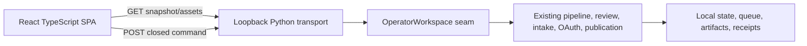

# TypeScript Local Operator Console — Implementation Plan

## Goal

Replace the current minimal loopback page with a packaged React, Vite, and
TypeScript single-page application. It gives one local operator a complete,
accessible interface for the existing CLI workflow without creating a second
workflow implementation. Python remains authoritative for snapshots, command
validation, locks, state transitions, review behavior, OAuth initiation,
publication ordering, artifacts, and error translation.

The workspace has exactly five sidebar pages:

1. Candidates
2. Intake
3. Pipeline
4. Review
5. Outcomes

`social-agent workspace` remains the one operator command. It binds only to
loopback and serves packaged static assets; production use requires no Vite dev
server.

## Non-negotiable boundaries

- Browser code never reads or writes queue, state, candidate, manifest, or
  publication files directly.
- Every mutation is a closed, action-specific command submitted to
  `OperatorWorkspace`.
- Acceptance means: create the immutable approved draft, then immediately
  attempt X publication before LinkedIn publication with the approved image.
- `unknown` publication outcomes are read-only and non-retryable.
- Only an active candidate may be permanently deleted. Promoted candidates
  remain retained. Deletion requires a two-step confirmation and writes a
  minimal local event without source content.
- The UI never exposes OAuth tokens, authorization codes, secrets, environment
  exports, arbitrary filesystem paths, remote administration, scheduling,
  analytics, organization publishing, or remote editing/deletion.

## Architecture

The TypeScript app owns presentation state only: route selection, card/detail
selection, modal state, focus management, polling, loading/error rendering,
and toast lifecycle. It does not calculate stages, infer allowed commands, or
reconstruct workflow data from files.

## Phase 0 — Replace the temporary page safely

- Remove the Python-string HTML/JavaScript workspace UI after the new app is
  ready; retain the existing loopback transport and CSP-safe asset handling.
- Add `web/` with Vite, React, TypeScript strict mode, a lockfile, formatting,
  unit/component tests, and build scripts.
- Configure the Python package to include the built, hashed frontend assets and
  an asset manifest in the wheel.
- Make `social-agent workspace` resolve only manifest-declared assets and use
  `script-src 'self'`; do not re-enable inline scripts.
- Update legacy-removal checks and documentation that currently prohibit Node
  assets, explicitly superseding that narrow removal decision through ADR 0002.

**Gate:** a packaged Python build serves the React shell and its hashed assets
from loopback; no frontend dev server is required for an operator.

## Phase 1 — Strengthen the Python workspace seam

- Replace loose snapshot dictionaries with versioned, serializable workspace
  view models. Keep secrets and absolute paths out of all views.
- Add a versioned command-status record: command kind, target post/candidate
  when applicable, started/updated/completed timestamps, result message, and
  safe failure category. Persist it atomically and expose it in every snapshot.
- Ensure local run-lock contention and a running command both produce the same
  observable disabled/conflict state.
- Refactor duplicate CLI orchestration into reusable application behavior so
  CLI and workspace commands call the same run, resume, retry, intake, OAuth,
  promotion, and review operations.
- Add candidate deletion as a closed command. Validate that the candidate is
  active, atomically remove it from the register, and append a minimal deletion
  event. Reject promoted, expired, unknown, and malformed IDs.
- Extend review views to expose package evidence for `human_review` and
  `rejected` posts. Keep rejected views inspection-only unless an existing
  valid operation explicitly reopens them.

**Gate:** seam tests use a fake application adapter to prove snapshots,
commands, command conflicts, deletion restrictions, review action validation,
and X-before-LinkedIn acceptance delegation.

## Phase 2 — Typed local web transport

- Define stable `/api/v1/` endpoints for the workspace snapshot, command
  submission, selected post/review data, and validated post-package images.
- Preserve a closed command schema per action rather than accepting optional
  fields unrelated to an action.
- Serve only manifest-listed frontend assets and images resolved through the
  post-package confinement check; reject traversal, unknown asset names, and
  arbitrary filesystem paths.
- Provide consistent error payloads for invalid state, unavailable
  configuration, lock contention, stale target, and command failure.
- Add explicit endpoint contracts for candidate deletion, command polling, and
  OAuth readiness; never return credential values.

**Gate:** temporary-workspace transport tests cover dashboard data, filtering,
commands, review/image access, asset confinement, CSP, and secret exclusion.

## Phase 3 — App shell and shared interaction system

- Implement a persistent dark sidebar with the five agreed routes, a light
  reading surface, responsive desktop-first layout, visible focus styles, and
  keyboard-operable dialogs.
- Create typed API client models generated or manually aligned with the Python
  versioned view contracts.
- Build shared status chips, empty/error/loading states, toast notifications,
  confirmation modal, evidence panel, command bar, and Previous/Next navigator.
- Poll snapshots every 2–3 seconds while a command is active; the global
  command bar shows command, target, stage, elapsed time, result/failure, and
  disables conflicting controls.
- Add route-level tests for navigation, focus trapping, disabled controls, and
  command feedback.

**Gate:** all five routes render against fixture snapshots with keyboard-only
navigation and no browser console errors.

## Phase 4 — Candidates and Intake pages

### Candidates

- Render navigable cards/list and a detail pane with status, score, rationale,
  provenance, evidence notes, angle, audience, and professional-use-case
  translation.
- Filter by active, promoted, and expired lifecycle state; retain audit history
  for non-deleted records.
- Provide Promote only for active candidates. Explain already queued, promoted,
  and expired failures from the backend’s safe messages.
- Provide Delete permanently only for active candidates. The first modal shows
  title and normalized URL; the second explicit confirmation sends the closed
  delete command. Never provide queue/post deletion.

### Intake

- Display the operator-maintained source configuration as untrusted
  configuration, latest report, retained candidates, expiry, and safe skips.
- Provide the bounded read-only Run intake action, with command progress and no
  drafting/publishing language or controls.

**Gate:** component and transport tests cover filters, card navigation,
promotion, two-step active deletion, rejected deletion targets, report display,
and intake command status.

## Phase 5 — Pipeline and Review pages

### Pipeline

- Show the active post, stage timeline, resume point, attempts, failures, and
  terminal states.
- Provide Run default queue, Resume, Retry one failed post, and Retry all
  failed posts. Do not expose arbitrary local queue-path input; the CLI remains
  available for that exceptional operation.

### Review

- Navigate with Previous/Next across `human_review` and rejected packages.
- Render source provenance/evidence, X and LinkedIn renderings, validation and
  semantic-review findings, exact generated image, and immutable status.
- For a reviewable post, expose command buttons for validation/rewrite where
  supported by existing behavior, regenerate text/image with required feedback,
  explicit local image selection/replacement, save/quit, skip, reject, and
  accept-and-publish.
- Rejected posts render the same evidence for operator analysis but remain
  visibly read-only/terminal unless a valid existing workflow operation permits
  a state change.
- Acceptance uses an unambiguous modal with the exact X-then-LinkedIn safety
  consequence and no later scheduling step.

**Gate:** browser tests prove post navigation, mandatory feedback, image
preview/replacement validation, rejected-package read-only behavior, acceptance
confirmation text, and preservation of the existing immutable-manifest plus
publication-order behavior.

## Phase 6 — Outcomes and OAuth page behavior

- Show every approved package’s X and LinkedIn outcome, durable receipt links
  where present, pending/failed state, and safe diagnostic message.
- Render `unknown` outcomes with a prominent non-retryable explanation and no
  retry control.
- Show OAuth readiness by platform and three explicit local initiation buttons:
  Connect X, Connect LinkedIn, Connect both. Never expose sensitive OAuth data.

**Gate:** mocked publication and OAuth tests verify safe status rendering,
receipt visibility, unknown non-retryability, and secret exclusion.

## Phase 7 — Quality, packaging, and rollout

- Add frontend lint, TypeScript typecheck, component tests, and production build
  to the developer and CI commands alongside existing `uv` checks.
- Add end-to-end browser tests using temporary workspaces and fake local
  adapters. Do not call authenticated external services by default.
- Validate a built wheel/package in a clean environment, then run
  `social-agent workspace` and verify all assets load from loopback.
- Update README, operator workflow, decisions, testing docs, and project status
  with the new local console and the unchanged approval/publication boundaries.
- Retain the CLI as a fully supported alternative for all existing commands.

**Final gate:** Python lint/typecheck/offline suite, frontend lint/typecheck/unit
suite/production build, loopback browser integration suite, package smoke test,
and an operator-reviewed manual acceptance flow all pass.

## Delivery slices

Deliver vertical slices in this order:

1. Packaged shell + typed snapshot + five empty routes.
2. Candidates list/detail/filter/promotion.
3. Intake report/configuration/run action.
4. Pipeline status/run/resume/retry and command bar.
5. Review navigation/evidence/image/actions/acceptance confirmation.
6. Outcomes/receipts/OAuth actions.
7. Active candidate deletion, final accessibility, tests, and documentation.

Each slice begins with a red test at its public seam, then minimal behavior,
typechecking, focused tests, and review before proceeding.
